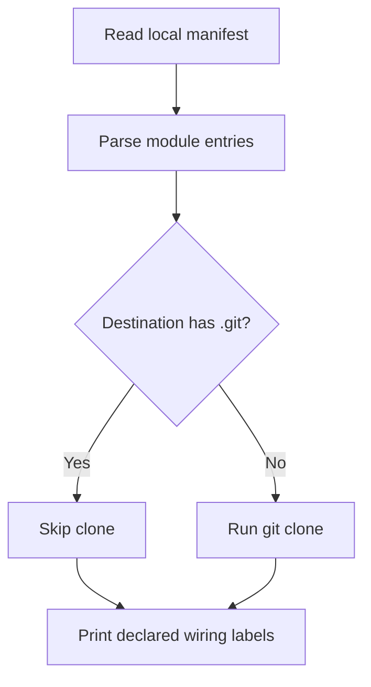

# agent-ops-stack

> This concise entrypoint replaces the long-form predecessor archived at [`docs/archive/2026-10-12/README.md`](docs/archive/2026-10-12/README.md). The archive is historical; its security, capability, and legal claims are superseded by the source-scoped descriptions below.

[Deutsche Version](README_de.md) | [Manifest](agent-ops.manifest.json) | [Installer](install.sh) | [Security policy](SECURITY.md) | [License inventory](THIRD_PARTY_LICENSES.md)

[](https://github.com/ellmos-ai/agent-ops-stack/actions/workflows/ci.yml) [](LICENSE)

`agent-ops-stack` is a Git repository containing a JSON manifest, a Bash installer, and documentation. The installer clones the seven repositories named in the manifest and prints their declared `provides` and `consumes` labels. It does not run or configure those modules.

### Quick navigation

1. [Overview](#current-01)
2. [What this repository does](#current-02)
3. [Intended use](#current-03)
4. [Scope](#current-04)
5. [Manifest modules](#current-05)
6. [Installer flow](#current-06)
7. [Network and process behavior](#current-07)
8. [Trust boundaries](#current-08)
9. [Using the checkout](#current-09)
10. [Installation](#current-10)
11. [Manifest fields](#current-11)
12. [Related repositories](#current-12)
13. [Refs and version metadata](#current-13)
14. [Security limits](#current-14)
15. [Third-party licenses](#current-15)
16. [Developer checks](#current-16)
17. [Security reports](#current-17)
18. [License and legal scope](#current-18)

<a id="current-01"></a>
<a id="sec-01"></a>
<a id="1-overview--architecture"></a>
<a id="overview--architecture"></a>
<a id="1-ueberblick--architektur"></a>
<a id="ueberblick--architektur"></a>
<a id="1-architecture--overview"></a>
<a id="architecture--overview"></a>
## 1. Overview

`agent-ops-stack` is a manifest-driven source fetcher for seven independently maintained agent-operations repositories. The project files are the manifest, `install.sh`, CI and tests, and documentation.

<a id="current-02"></a>
<a id="sec-02"></a>
<a id="2-what-is-agent-ops"></a>
<a id="what-is-agent-ops"></a>
<a id="2-was-ist-agent-ops"></a>
<a id="was-ist-agent-ops"></a>
## 2. What this repository does

`agent-ops.manifest.json` names the source repositories and refs and records declared wiring labels. `install.sh` reads the manifest, clones the sources with Git, and prints those labels. Each repository remains its own project.

<a id="current-03"></a>
<a id="sec-03"></a>
<a id="3-target-personas--discoverability"></a>
<a id="target-personas--discoverability"></a>
<a id="3-zielgruppen--auffindbarkeit"></a>
<a id="zielgruppen--auffindbarkeit"></a>
## 3. Intended use

Use this checkout when you want the listed source repositories fetched from one manifest. Review the selected refs and upstream setup instructions before using each module.

<a id="current-04"></a>
<a id="sec-04"></a>
<a id="4-comparative-matrix-vs-alternatives"></a>
<a id="comparative-matrix-vs-alternatives"></a>
<a id="4-vergleichsmatrix-gegenueber-alternativen"></a>
<a id="vergleichsmatrix-gegenueber-alternativen"></a>
## 4. Scope

This repository maintains a list of source refs and a fetch/report script. Module behavior and any connections between modules are documented and configured in their own repositories.

<a id="current-05"></a>
<a id="sec-05"></a>
<a id="5-composed-modules-the-7-pillars"></a>
<a id="composed-modules-the-7-pillars"></a>
<a id="5-komponierte-module-die-7-saeulen"></a>
<a id="komponierte-module-die-7-saeulen"></a>
<a id="3-composed-modules-the-7-pillars"></a>
## 5. Manifest modules

The manifest currently lists these seven repositories. The `provides` values below are the labels recorded in the JSON file.

| Module | Ref | Declared `provides` |
| --- | --- | --- |
| [ticket-master](https://github.com/dev-bricks/ticket-master) | `v1.11.3` | `ticket-routing` |
| [lock-master](https://github.com/dev-bricks/lock-master) | `main` | `locking` |
| [sync-master](https://github.com/dev-bricks/sync-master) | `main` | `file-sync` |
| [build-your-users-mind](https://github.com/ellmos-ai/build-your-users-mind) | `master` | `decision-avatar` |
| [skills](https://github.com/ellmos-ai/skills) | `v2026.09.03` | `skill-pack` |
| [controlcenter-mcp](https://github.com/ellmos-ai/ellmos-controlcenter-mcp) | `main` | `control-plane` |
| [homebase-mcp](https://github.com/ellmos-ai/ellmos-homebase-mcp) | `main` | `mcp-runtime`, `memory-facade`, `task-facade` |

<a id="current-06"></a>
<a id="sec-06"></a>
<a id="6-system-architecture-flowchart"></a>
<a id="system-architecture-flowchart"></a>
<a id="6-systemarchitektur-flussdiagramm"></a>
<a id="systemarchitektur-flussdiagramm"></a>
<a id="4-system-architecture-flowchart"></a>
## 6. Installer flow

For each manifest entry, the installer checks whether the destination already contains a Git checkout. It skips that clone or invokes `git clone`, then prints the manifest's wiring labels.



<a id="current-07"></a>
<a id="sec-07"></a>
<a id="7-multi-agent-operational-lifecycle-sequence"></a>
<a id="multi-agent-operational-lifecycle-sequence"></a>
<a id="7-multi-agenten-lebenszyklus-sequenz"></a>
<a id="multi-agenten-lebenszyklus-sequenz"></a>
<a id="5-multi-agent-operational-lifecycle-sequence"></a>
## 7. Network and process behavior

The clone step contacts GitHub through Git. The installer also requires Bash and either `jq` or Python 3 to parse the local manifest. Build and test tools are separate development requirements.

<a id="current-08"></a>
<a id="sec-08"></a>
<a id="8-governance--runtime-invariants"></a>
<a id="governance--runtime-invariants"></a>
<a id="8-governance--laufzeit-invarianten"></a>
<a id="governance--laufzeit-invarianten"></a>
<a id="6-governance--runtime-invariants"></a>
## 8. Trust boundaries

The manifest's `boundaries` and `wiring` entries are descriptive data. They do not restrict filesystem access, network access, process privileges, or tools. `install.sh` runs Git and the JSON parser with the invoking user's environment and permissions, and writes to the chosen target path. Review module source and choose a target you intend to modify.

<a id="current-09"></a>
<a id="sec-09"></a>
<a id="9-how-an-agent-uses-this-stack"></a>
<a id="how-an-agent-uses-this-stack"></a>
<a id="9-wie-ein-agent-diesen-stack-nutzt"></a>
<a id="wie-ein-agent-diesen-stack-nutzt"></a>
<a id="7-how-an-agent-uses-this-stack"></a>
## 9. Using the checkout

By default, clones go to `modules` beneath the current working directory. Pass an optional first argument to choose another target. Destinations that already contain `.git` are skipped. The final output reports declared `provides` and `consumes` labels.

<a id="current-10"></a>
<a id="sec-10"></a>
<a id="10-quickstart--installation"></a>
<a id="quickstart--installation"></a>
<a id="10-schnellstart--installation"></a>
<a id="schnellstart--installation"></a>
<a id="8-quickstart--installation"></a>
## 10. Installation

Requirements: Git, Bash, and either `jq` or Python 3. Cloning needs network access to the listed public repositories.

```sh
git clone https://github.com/ellmos-ai/agent-ops-stack.git
cd agent-ops-stack
bash ./install.sh

# Optional target directory
bash ./install.sh path/to/modules
```

Use the Git checkout and installer as the project workflow. The Python wheel contains project metadata and license files; it does not install an agent-operations runtime.

<a id="current-11"></a>
<a id="sec-11"></a>
<a id="11-manifest-schema-specification"></a>
<a id="manifest-schema-specification"></a>
<a id="11-manifest-schema-spezifikation"></a>
<a id="manifest-schema-spezifikation"></a>
<a id="9-manifest-schema-specification"></a>
## 11. Manifest fields

Each module record contains a name, source repository and ref, kind, descriptive `boundaries`, and `wiring` fields. The installer uses source and wiring fields; it does not enforce `boundaries`.

<a id="current-12"></a>
<a id="sec-12"></a>
<a id="12-sibling-ecosystem--cross-integration-matrix"></a>
<a id="sibling-ecosystem--cross-integration-matrix"></a>
<a id="12-geschwister-oekosystem--integrationsmatrix"></a>
<a id="geschwister-oekosystem--integrationsmatrix"></a>
<a id="10-sibling-ecosystem--cross-integration-matrix"></a>
## 12. Related repositories

The seven manifest repositories and their declared capabilities are listed in section 5. The independent siblings below have no manifest entry or integrated runtime relationship.

| Repository | Relationship |
| --- | --- |
| [COMA](https://github.com/ellmos-ai/coma) | Optional sibling for local agent process lifecycle and job-file status; not listed in this stack manifest |
| [CareCenter for Codex](https://github.com/dev-bricks/CareCenter-for-Codex) | Optional sibling with unofficial Windows Codex maintenance instructions; independently maintained |
| [ellmos-ai/stacks](https://github.com/ellmos-ai/stacks) | Catalog and composition overview; independently maintained |
| [open-bricks](https://github.com/open-bricks) | Umbrella organization |

A manifest entry or sibling link does not establish compatibility or an integrated runtime.

<a id="current-13"></a>
<a id="sec-13"></a>
<a id="13-search-seo--disambiguation"></a>
<a id="search-seo--disambiguation"></a>
<a id="13-suche-seo--begriffsklaerung"></a>
<a id="suche-seo--begriffsklaerung"></a>
<a id="11-search--disambiguation"></a>
## 13. Refs and version metadata

The manifest uses two named tags and five branch refs. Branch refs can move, and a tag name is not a commit-level integrity guarantee. Check the upstream ref when reproducibility matters. Project metadata currently records version `1.3.4`; the wheel is metadata-only and is not the installer.

<a id="current-14"></a>
<a id="sec-14"></a>
<a id="14-security-model--threat-mitigation"></a>
<a id="security-model--threat-mitigation"></a>
<a id="14-sicherheitsmodell--bedrohungsabwehr"></a>
<a id="sicherheitsmodell--bedrohungsabwehr"></a>
## 14. Security limits

See [SECURITY.md](SECURITY.md) for the project's security boundary, vulnerability-reporting route, and maintainer response policy. The scope described there applies to this repository and its installer.

<a id="current-15"></a>
<a id="sec-15"></a>
<a id="15-third-party-licenses--transparency"></a>
<a id="third-party-licenses--transparency"></a>
<a id="15-drittanbieter-lizenzen--transparenz"></a>
<a id="drittanbieter-lizenzen--transparenz"></a>
<a id="13-third-party-licenses--transparency"></a>
## 15. Third-party licenses

[`LICENSE`](LICENSE) covers this repository. The dated [`THIRD_PARTY_LICENSES.md`](THIRD_PARTY_LICENSES.md) inventory records a limited direct-source license check and its scope; it is not a complete SBOM.

<a id="current-16"></a>
<a id="sec-16"></a>
<a id="16-verification--automated-test-suite"></a>
<a id="verification--automated-test-suite"></a>
<a id="16-verifikation--automatisierte-testsuite"></a>
<a id="verifikation--automatisierte-testsuite"></a>
<a id="12-security--verification"></a>
## 16. Developer checks

From a checkout, run the configured checks:

```sh
python -m pytest -o addopts='' -ra
python -m ruff check .
python -m compileall -q tests
bash -n install.sh
python -m json.tool agent-ops.manifest.json
```

The tests validate this repository's manifest, metadata, docs structure, and CI configuration. They do not verify independent modules or provider CLIs.

Ubuntu CI also builds the PEP 517 wheel and source archive, verifies the metadata-only wheel and allowed source files, and installs the test extra from the extracted source archive before running checks.

<a id="current-17"></a>
<a id="sec-17"></a>
<a id="17-security-policy--slas"></a>
<a id="security-policy--slas"></a>
<a id="17-sicherheitsrichtlinie--slas"></a>
<a id="sicherheitsrichtlinie--slas"></a>
## 17. Security reports

Report vulnerabilities through [GitHub Security Advisories](https://github.com/ellmos-ai/agent-ops-stack/security/advisories/new). The maintainer policy is to acknowledge within 48 hours and provide an initial triage assessment within five business days. These response targets do not promise a fix by a particular date.

<a id="current-18"></a>
<a id="sec-18"></a>
<a id="18-license--liability--haftung"></a>
<a id="license--liability--haftung"></a>
<a id="18-lizenz--haftung--liability"></a>
<a id="lizenz--haftung--liability"></a>
<a id="14-license"></a>
<a id="15-liability--haftung"></a>
## 18. License and legal scope

This repository is licensed under MIT; see [`LICENSE`](LICENSE). Whether statutory provisions such as sections 516 or 521 BGB apply depends on the legal relationship and applicable law. This documentation does not classify every use as a gift or make a blanket statement about liability.
