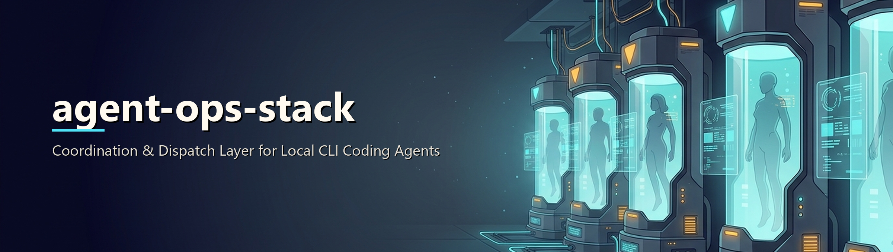
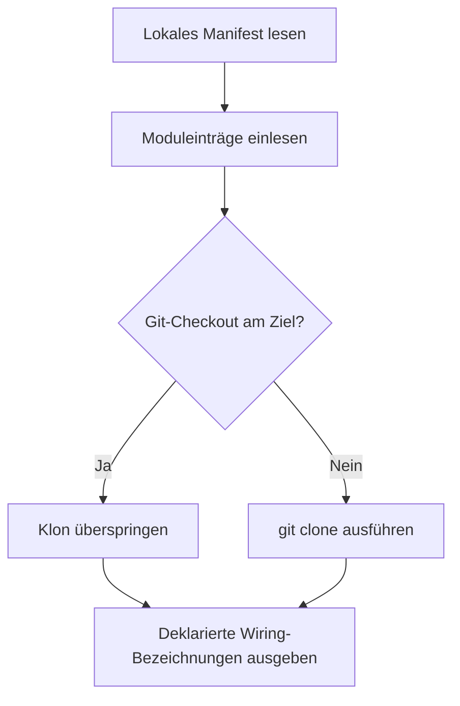

# agent-ops-stack

> Dieser kompakte Einstieg ersetzt die Langfassung unter [`docs/archive/2026-10-12/README_de.md`](docs/archive/2026-10-12/README_de.md). Das Archiv ist historisch; seine Sicherheits-, Funktions- und Rechtsaussagen werden durch die nachstehenden, am Quellcode ausgerichteten Beschreibungen ersetzt.

[English version](README.md) | [Manifest](agent-ops.manifest.json) | [Installer](install.sh) | [Sicherheitsrichtlinie](SECURITY.md) | [Lizenzinventur](THIRD_PARTY_LICENSES.md)

[](https://github.com/ellmos-ai/agent-ops-stack/actions/workflows/ci.yml) [](LICENSE)

`agent-ops-stack` ist ein Git-Repository mit einem JSON-Manifest, einem Bash-Installer und Dokumentation. Der Installer klont die sieben im Manifest genannten Repositories und gibt deren deklarierte `provides`- und `consumes`-Bezeichnungen aus. Er startet oder konfiguriert diese Module nicht.

### Schnellnavigation

1. [Überblick](#current-01)
2. [Was dieses Repository tut](#current-02)
3. [Vorgesehene Nutzung](#current-03)
4. [Umfang](#current-04)
5. [Manifest-Module](#current-05)
6. [Installer-Ablauf](#current-06)
7. [Netzwerk und Prozesse](#current-07)
8. [Vertrauensgrenzen](#current-08)
9. [Checkout verwenden](#current-09)
10. [Installation](#current-10)
11. [Manifestfelder](#current-11)
12. [Verwandte Repositories](#current-12)
13. [Referenzen und Versionsmetadaten](#current-13)
14. [Sicherheitsgrenzen](#current-14)
15. [Drittanbieter-Lizenzen](#current-15)
16. [Entwicklerprüfungen](#current-16)
17. [Sicherheitsmeldungen](#current-17)
18. [Lizenz und rechtlicher Umfang](#current-18)

<a id="current-01"></a>
<a id="sec-01"></a>
<a id="1-ueberblick--architektur"></a>
<a id="ueberblick--architektur"></a>
<a id="1-overview--architecture"></a>
<a id="overview--architecture"></a>
<a id="1-architektur--überblick"></a>
<a id="architektur--überblick"></a>
## 1. Überblick

`agent-ops-stack` ist ein manifestgesteuerter Quellabruf für sieben unabhängig gepflegte Agentenbetriebs-Repositories. Zum Projekt gehören Manifest, `install.sh`, CI und Tests sowie Dokumentation.

<a id="current-02"></a>
<a id="sec-02"></a>
<a id="2-was-ist-agent-ops"></a>
<a id="was-ist-agent-ops"></a>
<a id="2-what-is-agent-ops"></a>
<a id="what-is-agent-ops"></a>
## 2. Was dieses Repository tut

`agent-ops.manifest.json` nennt Quell-Repositories und Referenzen und enthält deklarierte Verknüpfungsbezeichnungen. `install.sh` liest das Manifest, klont die Quellen mit Git und gibt die Bezeichnungen aus. Jedes Repository bleibt ein eigenes Projekt.

<a id="current-03"></a>
<a id="sec-03"></a>
<a id="3-zielgruppen--auffindbarkeit"></a>
<a id="zielgruppen--auffindbarkeit"></a>
<a id="3-target-personas--discoverability"></a>
<a id="target-personas--discoverability"></a>
## 3. Vorgesehene Nutzung

Verwende diesen Checkout, wenn du die aufgeführten Quell-Repositories anhand eines Manifests abrufen möchtest. Prüfe die Referenzen und die Einrichtungsanleitungen im jeweiligen Upstream, bevor du ein Modul verwendest.

<a id="current-04"></a>
<a id="sec-04"></a>
<a id="4-vergleichsmatrix-gegenueber-alternativen"></a>
<a id="vergleichsmatrix-gegenueber-alternativen"></a>
<a id="4-comparative-matrix-vs-alternatives"></a>
<a id="comparative-matrix-vs-alternatives"></a>
## 4. Umfang

Dieses Repository pflegt eine Liste von Quellreferenzen sowie ein Abruf- und Ausgabeskript. Verhalten der Module und mögliche Verbindungen zwischen ihnen werden in den jeweiligen Repositories dokumentiert und eingerichtet.

<a id="current-05"></a>
<a id="sec-05"></a>
<a id="5-komponierte-module-die-7-saeulen"></a>
<a id="komponierte-module-die-7-saeulen"></a>
<a id="5-composed-modules-the-7-pillars"></a>
<a id="composed-modules-the-7-pillars"></a>
<a id="3-komponierte-module-die-7-säulen"></a>
## 5. Manifest-Module

Das Manifest führt derzeit diese sieben Repositories auf. Die Werte unter `provides` sind die Bezeichnungen aus der JSON-Datei.

| Modul | Referenz | Deklariertes `provides` |
| --- | --- | --- |
| [ticket-master](https://github.com/dev-bricks/ticket-master) | `v1.11.3` | `ticket-routing` |
| [lock-master](https://github.com/dev-bricks/lock-master) | `main` | `locking` |
| [sync-master](https://github.com/dev-bricks/sync-master) | `main` | `file-sync` |
| [build-your-users-mind](https://github.com/ellmos-ai/build-your-users-mind) | `master` | `decision-avatar` |
| [skills](https://github.com/ellmos-ai/skills) | `v2026.09.03` | `skill-pack` |
| [controlcenter-mcp](https://github.com/ellmos-ai/ellmos-controlcenter-mcp) | `main` | `control-plane` |
| [homebase-mcp](https://github.com/ellmos-ai/ellmos-homebase-mcp) | `main` | `mcp-runtime`, `memory-facade`, `task-facade` |

<a id="current-06"></a>
<a id="sec-06"></a>
<a id="6-systemarchitektur-flussdiagramm"></a>
<a id="systemarchitektur-flussdiagramm"></a>
<a id="6-system-architecture-flowchart"></a>
<a id="system-architecture-flowchart"></a>
<a id="4-systemarchitektur-flussdiagramm"></a>
## 6. Installer-Ablauf

Für jeden Manifesteintrag prüft der Installer, ob am Ziel bereits ein Git-Checkout liegt. Er überspringt diesen Klon oder ruft `git clone` auf und gibt anschließend die Verknüpfungsbezeichnungen des Manifests aus.



<a id="current-07"></a>
<a id="sec-07"></a>
<a id="7-multi-agenten-lebenszyklus-sequenz"></a>
<a id="multi-agenten-lebenszyklus-sequenz"></a>
<a id="7-multi-agent-operational-lifecycle-sequence"></a>
<a id="multi-agent-operational-lifecycle-sequence"></a>
<a id="5-multi-agenten-lebenszyklus-sequenz"></a>
## 7. Netzwerk und Prozesse

Das Klonen greift über Git auf GitHub zu. Der Installer benötigt außerdem Bash und zum Einlesen des lokalen Manifests entweder `jq` oder Python 3. Build- und Testwerkzeuge sind separate Entwicklungsanforderungen.

<a id="current-08"></a>
<a id="sec-08"></a>
<a id="8-governance--laufzeit-invarianten"></a>
<a id="governance--laufzeit-invarianten"></a>
<a id="8-governance--runtime-invariants"></a>
<a id="governance--runtime-invariants"></a>
<a id="6-governance--laufzeit-invarianten"></a>
## 8. Vertrauensgrenzen

Die Einträge `boundaries` und `wiring` im Manifest sind beschreibende Daten. Sie beschränken weder Dateisystem- noch Netzwerkzugriff, Prozessrechte oder Werkzeuge. `install.sh` startet Git und den JSON-Parser mit Umgebung und Rechten des aufrufenden Benutzers und schreibt in den gewählten Zielpfad. Prüfe den Modulquellcode und wähle ein Ziel, das du verändern möchtest.

<a id="current-09"></a>
<a id="sec-09"></a>
<a id="9-wie-ein-agent-diesen-stack-nutzt"></a>
<a id="wie-ein-agent-diesen-stack-nutzt"></a>
<a id="9-how-an-agent-uses-this-stack"></a>
<a id="how-an-agent-uses-this-stack"></a>
<a id="7-wie-ein-agent-diesen-stack-nutzt"></a>
## 9. Checkout verwenden

Standardmäßig landen die Klone in `modules` unter dem aktuellen Arbeitsverzeichnis. Mit einem optionalen ersten Argument lässt sich ein anderes Ziel wählen. Ziele mit vorhandenem `.git`-Verzeichnis werden übersprungen. Die abschließende Ausgabe zeigt deklarierte `provides`- und `consumes`-Bezeichnungen.

<a id="current-10"></a>
<a id="sec-10"></a>
<a id="10-schnellstart--installation"></a>
<a id="schnellstart--installation"></a>
<a id="10-quickstart--installation"></a>
<a id="quickstart--installation"></a>
<a id="8-schnellstart--installation"></a>
## 10. Installation

Voraussetzungen: Git, Bash und entweder `jq` oder Python 3. Für das Klonen wird Netzwerkzugriff auf die aufgeführten öffentlichen Repositories benötigt.

```sh
git clone https://github.com/ellmos-ai/agent-ops-stack.git
cd agent-ops-stack
bash ./install.sh

# Optionales Zielverzeichnis
bash ./install.sh pfad/zu/modulen
```

Der vorgesehene Projektablauf nutzt den Git-Checkout und den Installer. Das Python-Wheel enthält Projektmetadaten und Lizenzdateien, aber keine Agentenbetriebs-Laufzeit.

<a id="current-11"></a>
<a id="sec-11"></a>
<a id="11-manifest-schema-spezifikation"></a>
<a id="manifest-schema-spezifikation"></a>
<a id="11-manifest-schema-specification"></a>
<a id="manifest-schema-specification"></a>
<a id="9-manifest-schema-spezifikation"></a>
## 11. Manifestfelder

Jeder Moduleintrag enthält Name, Quell-Repository und Referenz, Typ, beschreibende `boundaries`- und `wiring`-Felder. Der Installer nutzt Quelle und Verknüpfungsangaben; `boundaries` setzt er nicht durch.

<a id="current-12"></a>
<a id="sec-12"></a>
<a id="12-geschwister-oekosystem--integrationsmatrix"></a>
<a id="geschwister-oekosystem--integrationsmatrix"></a>
<a id="12-sibling-ecosystem--cross-integration-matrix"></a>
<a id="sibling-ecosystem--cross-integration-matrix"></a>
<a id="10-geschwister-oekosystem--integrationsmatrix"></a>
<a id="10-geschwister-ökosystem--integrationsmatrix"></a>
## 12. Verwandte Repositories

Die sieben Manifest-Repositories und ihre deklarierten Fähigkeiten stehen in Abschnitt 5. Die unabhängigen Geschwisterprojekte unten haben keinen Manifesteintrag und bilden keine integrierte Laufzeit.

| Repository | Beziehung |
| --- | --- |
| [COMA](https://github.com/ellmos-ai/coma) | Optionales Geschwisterprojekt für lokalen Agentenprozess-Lebenszyklus und Status von Jobdateien; nicht Teil dieses Stack-Manifests |
| [CareCenter for Codex](https://github.com/dev-bricks/CareCenter-for-Codex) | Optionales Geschwisterprojekt mit inoffiziellen Windows-Wartungshinweisen für Codex; unabhängig gepflegt |
| [ellmos-ai/stacks](https://github.com/ellmos-ai/stacks) | Katalog und Übersicht zur Zusammensetzung; unabhängig gepflegt |
| [open-bricks](https://github.com/open-bricks) | Dachorganisation |

Ein Manifesteintrag oder Geschwisterlink bestätigt weder Kompatibilität noch eine integrierte Laufzeit.

<a id="current-13"></a>
<a id="sec-13"></a>
<a id="13-suche-seo--begriffsklaerung"></a>
<a id="suche-seo--begriffsklaerung"></a>
<a id="13-search-seo--disambiguation"></a>
<a id="search-seo--disambiguation"></a>
<a id="11-suche--begriffsklaerung"></a>
<a id="11-suche--begriffsklärung"></a>
## 13. Referenzen und Versionsmetadaten

Das Manifest verwendet zwei benannte Tags und fünf Branch-Referenzen. Branch-Referenzen können sich ändern; ein Tagname ist keine Integritätsgarantie auf Commit-Ebene. Prüfe den Upstream-Stand, wenn Reproduzierbarkeit wichtig ist. Die Projektmetadaten nennen derzeit Version `1.3.4`; das Wheel enthält nur Metadaten und ist nicht der Installer.

<a id="current-14"></a>
<a id="sec-14"></a>
<a id="14-sicherheitsmodell--bedrohungsabwehr"></a>
<a id="sicherheitsmodell--bedrohungsabwehr"></a>
<a id="14-security-model--threat-mitigation"></a>
<a id="security-model--threat-mitigation"></a>
## 14. Sicherheitsgrenzen

Die [Sicherheitsrichtlinie](SECURITY.md) beschreibt Sicherheitsgrenzen, den Meldeweg und die Reaktionsrichtlinie der Maintainer. Ihr Umfang bezieht sich auf dieses Repository und seinen Installer.

<a id="current-15"></a>
<a id="sec-15"></a>
<a id="15-drittanbieter-lizenzen--transparenz"></a>
<a id="drittanbieter-lizenzen--transparenz"></a>
<a id="15-third-party-licenses--transparency"></a>
<a id="third-party-licenses--transparency"></a>
<a id="13-drittanbieter-lizenzen--transparenz"></a>
## 15. Drittanbieter-Lizenzen

[`LICENSE`](LICENSE) gilt für dieses Repository. Die datierte [`THIRD_PARTY_LICENSES.md`](THIRD_PARTY_LICENSES.md) dokumentiert eine begrenzte direkte Quelllizenzprüfung und ihren Umfang; sie ist keine vollständige SBOM.

<a id="current-16"></a>
<a id="sec-16"></a>
<a id="16-verifikation--automatisierte-testsuite"></a>
<a id="verifikation--automatisierte-testsuite"></a>
<a id="16-verification--automated-test-suite"></a>
<a id="verification--automated-test-suite"></a>
<a id="12-sicherheit--verifikation"></a>
## 16. Entwicklerprüfungen

Führe im Checkout die eingerichteten Prüfungen aus:

```sh
python -m pytest -o addopts='' -ra
python -m ruff check .
python -m compileall -q tests
bash -n install.sh
python -m json.tool agent-ops.manifest.json
```

Die Tests prüfen Manifest, Metadaten, Dokumentationsstruktur und CI-Konfiguration dieses Repositories. Sie prüfen keine unabhängigen Module oder Provider-CLIs.

Die Ubuntu-CI baut zusätzlich das PEP-517-Wheel und das Quellarchiv, prüft Metadaten und enthaltene Dateien und installiert das Test-Extra aus dem entpackten Quellarchiv, bevor sie dort die Prüfungen ausführt.

<a id="current-17"></a>
<a id="sec-17"></a>
<a id="17-sicherheitsrichtlinie--slas"></a>
<a id="sicherheitsrichtlinie--slas"></a>
<a id="17-security-policy--slas"></a>
<a id="security-policy--slas"></a>
## 17. Sicherheitsmeldungen

Melde Sicherheitslücken über [GitHub Security Advisories](https://github.com/ellmos-ai/agent-ops-stack/security/advisories/new). Die Maintainer-Richtlinie sieht eine Eingangsbestätigung binnen 48 Stunden und eine erste Triage-Einschätzung innerhalb von fünf Werktagen vor. Diese Reaktionsziele versprechen keine Behebung bis zu einem bestimmten Datum.

<a id="current-18"></a>
<a id="sec-18"></a>
<a id="18-lizenz--haftung--liability"></a>
<a id="lizenz--haftung--liability"></a>
<a id="18-license--liability--haftung"></a>
<a id="license--liability--haftung"></a>
<a id="14-lizenz"></a>
<a id="15-haftung--liability"></a>
## 18. Lizenz und rechtlicher Umfang

Dieses Repository steht unter der MIT-Lizenz; siehe [`LICENSE`](LICENSE). Ob gesetzliche Vorschriften wie §§ 516 oder 521 BGB gelten, hängt von der Rechtsbeziehung und dem anwendbaren Recht ab. Diese Dokumentation ordnet nicht jede Nutzung als Schenkung ein und trifft keine pauschale Aussage zur Haftung.
